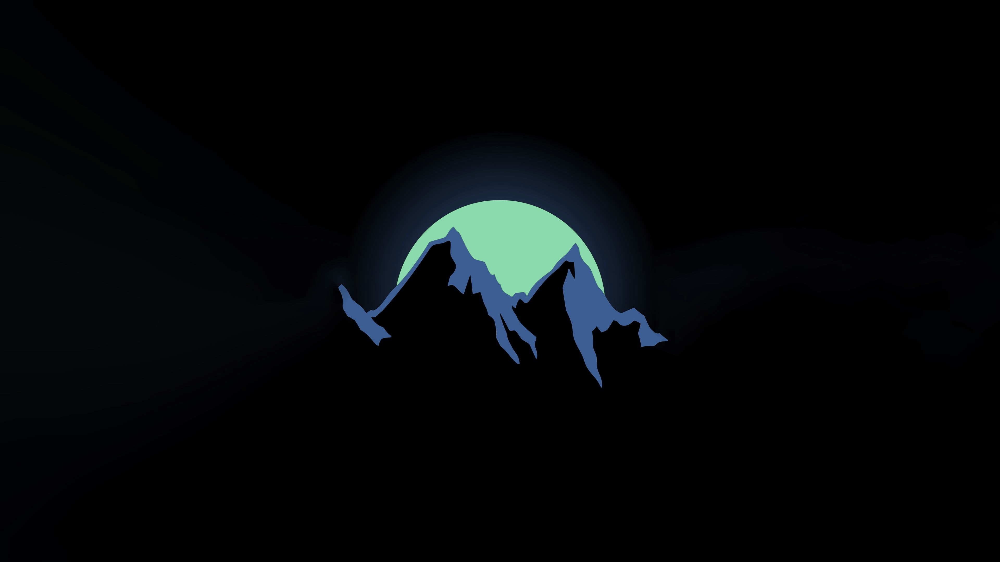
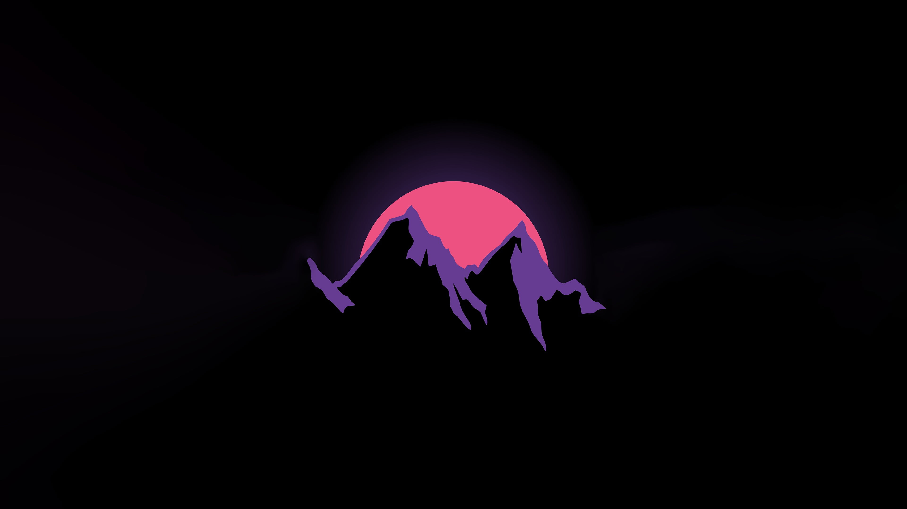
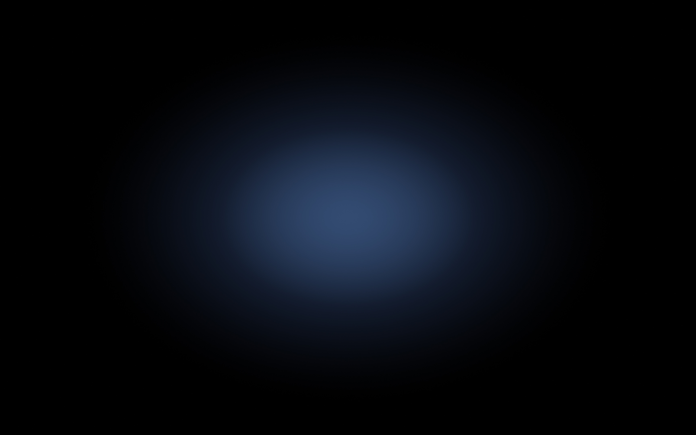

# Minimal wallpapers

## Blue mountain, green sun — current wallpaper (Linux)



- File: `blue-mountain-green-sun.jpg`
- A recolour of `synthwave-mountain-sun.jpg` below. It was converted to HSL and only the hue was remapped (purple to blue, pink to green), so the black stays black. The green is then set to a muted pastel mint (`#8bdaad`): the sun's hue is pinned, and its saturation and lightness are scaled so the flat sun lands on that colour while the glow and edges scale with it:

  ```sh
  magick synthwave-mountain-sun.jpg -colorspace HSL -channel R \
    -fx "hh = u < 0.1 ? u + 1 : u; qq = 0.60 - 0.9*(hh-0.75); hh >= 0.65 ? (qq < 0 ? qq + 1 : qq) : u" \
    -channel G -fx "u.r >= 0.3 && u.r <= 0.5 ? u*0.6417 : u" \
    -channel B -fx "u.r >= 0.3 && u.r <= 0.5 ? u*1.1227 : u" \
    -channel R -fx "u >= 0.3 && u <= 0.5 ? 0.4044 : u" \
    +channel -colorspace sRGB -quality 92 blue-mountain-green-sun.jpg
  ```

## Synthwave mountain sun



- File: `synthwave-mountain-sun.jpg`
- Resolution: 3840 × 2160 pixels, as downloaded; no resizing or editing.
- Source: [wallpaperflare.com](https://www.wallpaperflare.com/) (`wallpaper4.jpg`). The original artist is not credited there.
- License: **unknown.** wallpaperflare aggregates images without verifying rights, so this one's licence could not be confirmed.

Mostly black, with a small centred mountain and sun, so it stays out of the way behind windows.

## Pastel blue glow



- File: `pastel-blue-glow.jpg`
- Resolution: 3840 × 2400 pixels.
- Previously the Linux default wallpaper; still used as-is anywhere a near-black, low-detail background is wanted.
