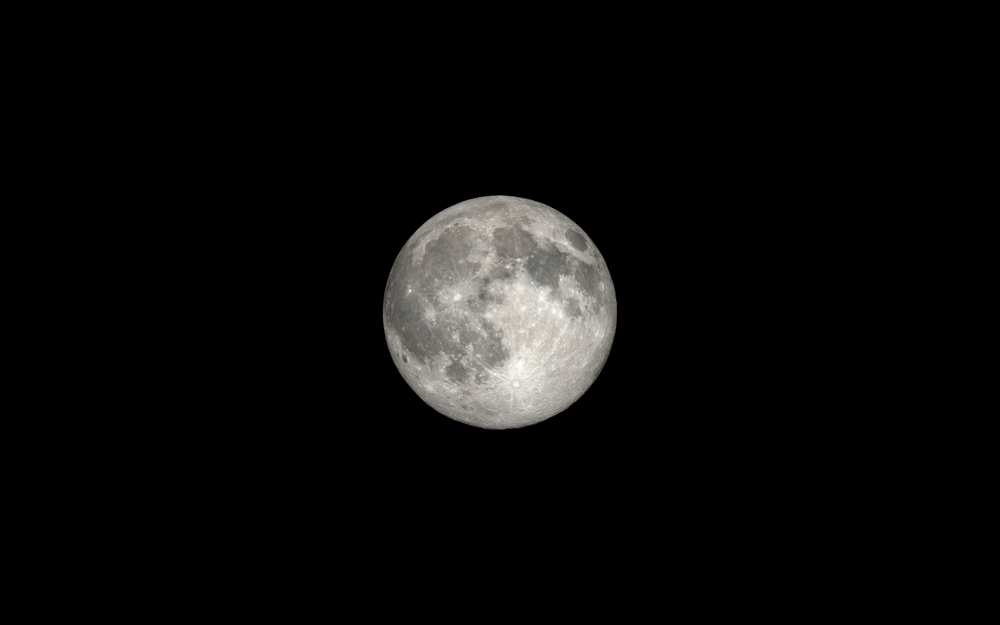

# Minimal wallpapers

## Full moon — current wallpaper (Linux)



- File: `full-moon.jpg`
- Resolution: 3840 × 2400 pixels; the Moon is 900 px across, centred on pure black.
- Source: NASA Scientific Visualization Studio, [Moon Phase and Libration, 2023](https://svs.gsfc.nasa.gov/5048) (`phase_full.1571.tif`, 3240 × 3240, the Moon 2777 px across). Rendered by Ernie Wright (USRA) from Lunar Reconnaissance Orbiter data: LROC WAC colour mosaics over LOLA elevation.
- License: public domain (NASA imagery). Credit: NASA's Scientific Visualization Studio.
- Downscaled in linear light, so the bright highlands don't darken at the edges, then placed on black:

  ```sh
  magick phase_full.1571.tif -colorspace RGB -filter Lanczos -resize 1050x1050 -colorspace sRGB \
    -background black -gravity center -extent 3840x2400 -quality 95 full-moon.jpg
  ```

## Blue mountain, green sun (Linux)


- File: `blue-mountain-green-sun.jpg`
- A recolour of `synthwave-mountain-sun.jpg` below. It was converted to HSL and only the hue was remapped (purple to blue, pink to green), so the black stays black. The green is then set to the Quickshell bar's workspace-2 green (`#8fd6b8`, `workspaceColor()` in `linux/configs/quickshell/shell.qml`): the sun's hue is pinned, and its saturation and lightness are scaled so the flat sun lands on that colour while the glow and edges scale with it:

  ```sh
  magick synthwave-mountain-sun.jpg -colorspace HSL -channel R \
    -fx "hh = u < 0.1 ? u + 1 : u; qq = 0.60 - 0.9*(hh-0.75); hh >= 0.65 ? (qq < 0 ? qq + 1 : qq) : u" \
    -channel G -fx "u.r >= 0.3 && u.r <= 0.5 ? u*0.5711 : u" \
    -channel B -fx "u.r >= 0.3 && u.r <= 0.5 ? u*1.1226 : u" \
    -channel R -fx "u >= 0.3 && u <= 0.5 ? 0.4296 : u" \
    +channel -colorspace sRGB -quality 92 blue-mountain-green-sun.jpg
  ```

## Synthwave mountain sun


- File: `synthwave-mountain-sun.jpg`
- Resolution: 3840 × 2160 pixels, as downloaded; no resizing or editing.
- Source: [wallpaperflare.com](https://www.wallpaperflare.com/) (`wallpaper4.jpg`). The original artist is not credited there.
- License: **unknown.** wallpaperflare aggregates images without verifying rights, so this one's licence could not be confirmed.

Mostly black, with a small centred mountain and sun, so it stays out of the way behind windows.

## Pastel blue glow


- File: `pastel-blue-glow.jpg`
- Resolution: 3840 × 2400 pixels.
- Previously the Linux default wallpaper; still used as-is anywhere a near-black, low-detail background is wanted.
- Generated, replacing the original slate-grey glow, whose egg-shaped hotspot was uneven. A clean 16-bit elliptical radial gradient is eased with smoothstep (`3u² − 2u³`, so there is no bright point and no hard edge), capped at 55% so the core stays a dim blue (`#324a70`), mapped through a black → navy → mid-blue → pastel ramp, and dithered with light noise against banding:

  ```sh
  magick \( -size 1x300 gradient:black-'#121b2c' \) \( -size 1x380 gradient:'#121b2c'-'#41608f' \) \
    \( -size 1x344 gradient:'#41608f'-'#a8c8f0' \) -append -rotate -90 clut.png
  magick -size 3840x2400 -depth 16 -define gradient:radii=1500,1050 radial-gradient:white-black \
    -fx 'u*u*(3-2*u)*0.55' -colorspace sRGB -type TrueColor clut.png -clut \
    -attenuate 0.4 +noise Uniform -quality 94 pastel-blue-glow.jpg
  ```

  Raise `0.55` for a brighter core (1.0 reaches the full pastel `#a8c8f0`), or change `radii` to resize the glow.
